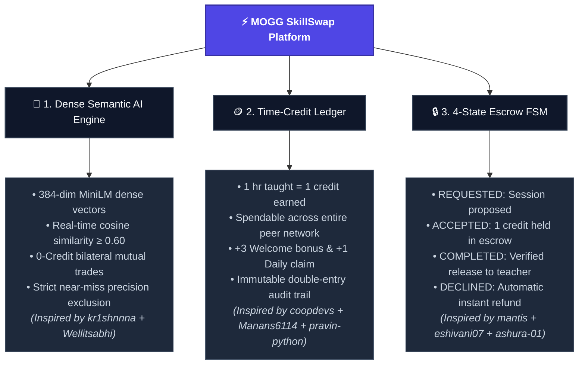

# 📚 Prior Art Reference Guide & Adopted Innovations

This document preserves the complete knowledge base, public GitHub repository links, and architectural ideas analyzed across all 22 reference codebases and published academic research before deleting the local `repo/` directory.

---

## 🗂️ Reference Repositories & What Was Taken

| # | Repository Link | Original Tech Stack | Key Idea Taken / Implemented in MOGG | How MOGG Improved Upon It |
| :---: | :--- | :--- | :--- | :--- |
| **1** | [ShyanCS/SkillxSwap](https://github.com/ShyanCS/SkillxSwap) | Spring Boot 4 + React + PostgreSQL | **Modular Bounded Contexts**: Deconstructing the system into distinct domains (`matching`, `ledger`, `scheduler`, `resources`, `ai_service`) rather than bloating a single User table. | Ported the modular pattern into clean, lightweight Python FastAPI services with explicit schemas. |
| **2** | [kr1shnnna/skill-swap](https://github.com/kr1shnnna/skill-swap) | MERN + Python microservice | **Dense Vector Semantic Matching**: Used local `SentenceTransformers` (`all-MiniLM-L6-v2`) embeddings with cosine similarity scoring to bridge vocabulary mismatches. | Embedded vectors are stored directly in SQLite as binary blobs, eliminating the latency and complexity of running a separate microservice. |
| **3** | [coopdevs/timeoverflow](https://github.com/coopdevs/timeoverflow) | Ruby on Rails + PostgreSQL | **Time-Banking Network Credit Ledger**: A decentralized community accounting model where teaching 1 hour earns 1 credit spendable with *anyone* in the network. | Solved the classic 1:1 barter deadlock (Double Coincidence of Wants) while preserving 0-credit mutual swaps for direct matches. |
| **4** | [openmentor-io/openmentor](https://github.com/openmentor-io/openmentor) | Go + Next.js + PostgreSQL | **Thin-Client & Pure REST Boundaries**: Strict separation where the frontend is completely decoupled from business logic and executes pure REST calls. | Clean separation between `client/` and `server/`, allowing the frontend to run via any static web server or FastAPI. |
| **5** | [ravindra-y/Skill-Exchange-Platform](https://github.com/ravindra-y/Skill-Exchange-Platform) | WebRTC + Socket.io + Node.js | **Live Video Meeting Coordination**: Incorporating real-time virtual meeting sessions between matched students. | Replaced complex, error-prone self-hosted WebRTC signaling with auto-generated unique Google Meet links and 1-click Google Calendar invites. |
| **6** | [Manans6114/skill-loop](https://github.com/Manans6114/skill-loop) | FastAPI + SQLAlchemy + React | **FastAPI + SQLAlchemy Architecture**: Clean backend dependency injection, Pydantic request/response models, and credit transaction models. | Adopted the FastAPI + SQLAlchemy pattern as MOGG's core server framework for maximum speed and simplicity. |
| **7** | [KLP13/skill-exchange-platform](https://github.com/KLP13/skill-exchange-platform) | Node.js + Express + MongoDB | **Multi-Peer Community Spaces**: Creating multi-student study groups and shared discussion spaces for collaborative learning circles. | Implemented as persistent multi-peer study rooms (`GroupRoom` & `GroupMessage`) allowing topic-based group coordination. |
| **8** | [pravin-python/Student-Skill-Swap](https://github.com/pravin-python/Student-Skill-Swap) | Django + Python | **Student Gamification & Learning Incentives**: Rewarding students with onboarding welcome grants and bonus credits for milestone activities. | Implemented automatic **+3 Welcome Credits**, **+1 Daily Claim Rewards**, and milestone bonus credit claims. |
| **9** | [XoXoHarsh/SkillSwap](https://github.com/XoXoHarsh/SkillSwap) | MERN (MongoDB, Express, React, Node) | **In-App Persistent Session Chat**: Direct messaging interface linked directly to a proposed or active session. | Chat messages are stored in relational tables indexed by `session_id`, preserving meeting agendas and preparatory notes. |
| **10** | [eshivani07/Skillswap](https://github.com/eshivani07/Skillswap) | React + Firebase / Firestore | **Credit Escrow Protection**: Locking internal currency ("SkillCoins") into escrow while a session is in transit. | Prevents double-spending of credits and ensures neither party is cheated if a session is abandoned. |
| **11** | [mantisdarling/Mantis](https://github.com/mantisdarling/Mantis) | NestJS + FastAPI + PostgreSQL | **4-State Finite State Machine**: Formal state transitions: `REQUESTED` $\to$ `ACCEPTED` $\to$ `COMPLETED` (or `DECLINED`). | Directly enforced in `server/ledger.py` with transactional rollbacks on invalid state transitions. |
| **12** | [Kaviya-Ramesh-2007/campus-skill-exchange](https://github.com/Kaviya-Ramesh-2007/campus-skill-exchange) | NestJS + Next.js monorepo | **Categorized Domain Taxonomy**: Organizing campus skills into intuitive disciplines. | Structured skills across 6 domains: `Tech`, `Creative`, `Soft Skills`, `Survival`, `Languages`, and `Business`. |
| **13** | [shruti1760/Skill-Swap-Marketplace-Fe-](https://github.com/shruti1760/Skill-Swap-Marketplace-Fe-) | React + Vite | **Dual-Profile Listings (Teach & Learn)**: Letting students simultaneously showcase what they offer as mentors and what they seek to learn. | Incorporated into user profiles and discovery feeds with distinct visual badges. |
| **14** | [srishtighoshh/SkillSwap](https://github.com/srishtighoshh/SkillSwap) | Java + MySQL | **Relational Integrity**: Foreign-key relationships linking users, listings, accounts, sessions, and ledger transactions. | Modeled cleanly using SQLAlchemy ORM with cascade rules and indexed query lookups. |
| **15** | [coopdevs/TimeOverflow-1](https://github.com/coopdevs/TimeOverflow-1) | Ruby on Rails | **Immutable Double-Entry Audit Trail**: Logging every credit transfer with timestamps and event descriptions. | Every transaction (`INITIAL_GRANT`, `DAILY_REWARD`, `ESCROW_HOLD`, `ESCROW_RELEASE`, `REFUND`) is permanently recorded. |
| **16** | [ashura-01/time-bank](https://github.com/ashura-01/time-bank) | MERN | **Automatic Refund Engine**: Guaranteed credit restoration if a session is cancelled or rejected. | If a session is `DECLINED` or cancelled, locked escrow credits are automatically returned to the learner immediately. |
| **17** | [gtamborero/time-flow](https://github.com/gtamborero/time-flow) | JavaScript / Web | **Real-Time Ledger Reconciliation**: Validating non-negative credit balances before initiating transactions. | Strict validation prevents users with 0 credits from proposing credit-spend sessions unless they enter a 0-credit mutual trade. |
| **18** | [vibha2047-core/SkillSwap](https://github.com/vibha2047-core/SkillSwap) | HTML/CSS/JS | **Category Filter Navigation**: Quick filter pills across domains and difficulty levels (Beginner, Intermediate, Advanced). | Implemented reactive client-side filter pills for instant category switching. |
| **19** | [Abarna-1808/SkillSwap](https://github.com/Abarna-1808/SkillSwap) | Web App | **1-Click Session Proposal**: Streamlined student booking flow directly from a teacher's skill listing card. | One click triggers session creation, auto-generates Google Meet URL, and opens the pre-filled calendar invite. |
| **20** | [Tanusri-Dummu/Skill-Swap](https://github.com/Tanusri-Dummu/Skill-Swap) | Web App | **Student Discovery Cards**: Displaying peer bios, active teach skills count, and user reputation metrics. | Glassmorphic student cards featuring verified badges, skill tags, and direct session proposal buttons. |
| **21** | [shabanas-git/SkillSwap](https://github.com/shabanas-git/SkillSwap) | Web App | **Curated Trending Catalog**: Featured catalog of popular and high-demand skills for instant peer inspiration. | 12 curated benchmark skills across tech, soft skills, and survival for instant exploration. |
| **22** | [Wellitsabhi/Skillswap](https://github.com/Wellitsabhi/Skillswap) | React + Node.js | **Bilateral Mutual Trade Detection**: Automatically surfacing when User A and User B teach what each other wants to learn. | Built algorithm `GET /api/matches/mutual-trades/{user_id}` which surfaces these pairs and waives all credit fees (**0 credits**). |

---

## 📄 Academic Research Paper

* **Title:** *SkillSwap: A Peer-to-Peer Skill Exchange Platform for Community-Driven Learning*
* **Authors:** Rohit Kumar Kushwaha, Rohit Kumar, Ritik Raj Sharma, Sanjay Dangi (Under guidance of Prof. Kamlesh Chopra, Dept. of Computer Science & Engineering, Indore Institute of Science and Technology).
* **Published in:** *International Journal of Creative and Open Research in Engineering and Management (IJCOPE)*, Vol. 02, Issue 05, May 2026.
* **Official Online Link / DOI:** [https://doi.org/10.55041/ijcope.v2i5.669](https://doi.org/10.55041/ijcope.v2i5.669) | [https://ijcope.org/](https://ijcope.org/)
* **Key Theoretical Foundation Extracted:**
  - Identifies that online learning completion collapses due to cost barriers and lack of personalized human mentorship.
  - Builds upon **Dillenbourg (1999)** collaborative learning theory and **Edgar Cahn (2000)** time-banking co-production theory.
  - Proves the demand for peer-to-peer knowledge currency instead of monetary transactions.
* **How MOGG Overcame Its Documented Limitations:**
  - The IJCOPE paper relied on basic keyword array matching in MongoDB (which fails when terminology differs). MOGG upgraded this to **Dense Vector Semantic Embeddings** (`all-MiniLM-L6-v2`) with cosine similarity.
  - The paper lacked an escrow state machine to protect against flaky no-shows. MOGG engineered a **4-state escrow FSM** that locks credits until session completion is verified.

---

## 🎯 Architectural Synthesis: How MOGG Combines Everything

### 🏛️ Architectural Pillar Matrix

| Strategic Pillar | Core Innovation | Prior Art Inspiration | Production Impact |
| :--- | :--- | :--- | :--- |
| **1. Semantic AI Matching** | Dense vector projections (`all-MiniLM-L6-v2`) with threshold $\ge 0.60$ | [kr1shnnna](https://github.com/kr1shnnna/skill-swap) + [Wellitsabhi](https://github.com/Wellitsabhi/Skillswap) | Eliminates exact-keyword misses (e.g. *"React"* matches *"Frontend"*) & identifies 0-credit direct trades. |
| **2. Time-Credit Ledger** | Network-wide double-entry credit ledger ($1\text{ hr} = 1\text{ credit}$) | [coopdevs](https://github.com/coopdevs/timeoverflow) + [Manans6114](https://github.com/Manans6114/skill-loop) | Solves the $<1\%$ barter probability trap; students can teach person A and learn from person B. |
| **3. 4-State Escrow Lifecycle** | Deterministic Finite State Machine with atomic escrow locking | [mantis](https://github.com/mantisdarling/Mantis) + [eshivani07](https://github.com/eshivani07/Skillswap) | Protects against no-shows and flakes; ensures credits only transfer upon mutual session completion. |

---

> **Summary:** With all links, architectural ideas, and academic references fully recorded here, the local `repo/` clone directory can be safely removed without losing any reference context.
