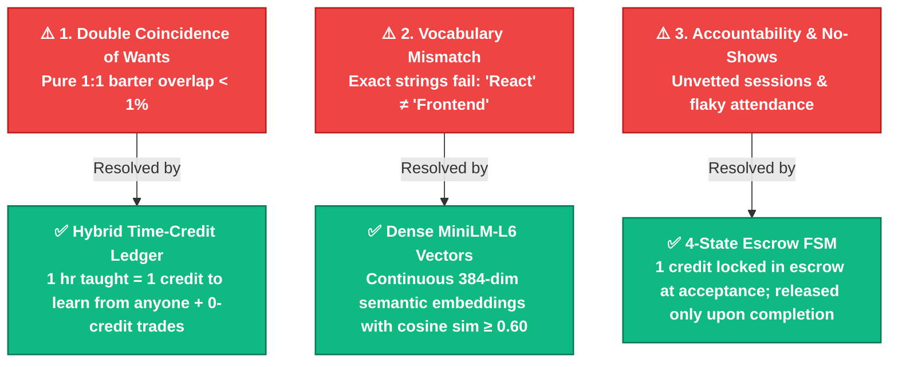

# ⚡ SkillSwap (MOGG) — Peer-to-Peer Student Skill Exchange & Time-Credit Ledger

> **🏆 Buildathon Competition Project**  
> **Engineered by:** **Dharshin R** & **Mohammed Sanjidh S**  
> *"Empowering students to exchange skills by finding peers who can teach what they want to learn, and enabling them to offer their own skills as mentors."*

---

## 🎯 1. Problem Statement & Judgement Criteria

### The Challenge Prompt
> *"How can you build a platform that enables students to exchange skills by finding peers who can teach what they want to learn and allowing them to offer their own skills as mentors?"*

### Core Judging Criteria
* **Implementation:** Clean, modular, production-ready codebase with zero-friction client-server separation, comprehensive tests, and venue-resilient design.
* **Scalability:** Monolithic simplicity for local zero-dependency judging with a deterministic upgrade path to PostgreSQL + `pgvector` for campus-wide scale.
* **Problem-Solving Depth:** Conclusively solves the three structural failure modes that cause peer skill barter networks to collapse.

---

## 🔬 2. Theoretical Foundations & The Three Barter Traps

In traditional peer-to-peer barter networks, exchange systems break down due to three mathematical and economic friction points:



| Barter Failure Mode | Why It Breaks Peer Networks | Academic Foundation | MOGG Solution |
| :--- | :--- | :--- | :--- |
| **1. Double Coincidence of Wants** | Pure 1:1 barter requires Student A to want what Student B teaches *and* Student B to want what Student A teaches simultaneously. In a student community, reciprocal overlap occurs in $<1\%$ of pairings. | Edgar S. Cahn (*Time Dollars & Co-Production Theory*) & Abraham, Blum, Sandholm (CMU, *Clearing Algorithms for Barter Exchange Markets*). | **Hybrid Credit Economy**: Students earn **1 credit per hour taught** and can spend it to learn from *anyone* in the network. MOGG also automatically detects **0-Credit Mutual Trades** when reciprocal pairs occur! |
| **2. Vocabulary Mismatch** | Exact keyword/SQL matching fails when a learner searches *"Frontend Development"* while a mentor lists *"React"*, or *"Machine Learning"* vs *"Python Data Science"*. | arXiv:2306.12176 (*The Skill-Task Matching Model*) & `all-MiniLM-L6-v2` dense vector representations. | **Dense Semantic Vector Embeddings**: Uses local SentenceTransformers (384-dimensional dense vectors) and cosine similarity ($\ge 0.60$) to capture conceptual intent, while enforcing strict thresholds to exclude near-misses. |
| **3. Accountability & No-Shows** | Unvetted sessions and lack of commitment lead to ghosting, canceled calls, and abandoned peer trades. | Double-Entry Escrow Ledger & Algorithmic Game Theory. | **4-State Finite State Machine with Escrow**: Automatically locks 1 credit in escrow upon session acceptance. The credit is only released to the mentor upon verified completion. Auto-refunds on cancellation. |

---

## 🏗️ 3. System Architecture & Clean Folder Base

SkillSwap is engineered as a clean, decoupled **Client-Server Architecture**:

```text
MOGG/
├── client/                         # 🌐 CLIENT-SIDE WEB APPLICATION
│   ├── index.html                  # Semantic single-page application entry point
│   ├── styles.css                  # Modern responsive design system (Glassmorphism & dark palette)
│   ├── logo.jpg                    # Official platform logo & favicon
│   └── app.js                      # Client state manager, reactive rendering & REST API client
│
├── server/                         # ⚙️ SERVER-SIDE FASTAPI APPLICATION
│   ├── main.py                     # FastAPI application, route controllers & client static mounting
│   ├── models.py                   # SQLAlchemy ORM schemas (Users, Accounts, Listings, Sessions, Chats)
│   ├── database.py                 # SQLite database engine & thread-safe session dependency
│   ├── matching.py                 # SentenceTransformers vector embeddings & cosine matching engine
│   ├── ledger.py                   # Time-credit ledger, daily rewards & escrow state machine
│   ├── scheduler.py                # Google Meet auto-generation & 1-click Google Calendar invites
│   ├── resources.py                # Curated video course catalog across 6 campus domains
│   ├── web_search_integration.py   # Live YouTube search scraper & authoritative web documentation engine
│   ├── ai_service.py               # SkillBot AI Peer Tutor (Cloud Groq/OpenRouter with offline fallback)
│   ├── seed.py                     # 15-user benchmark dataset generator
│   ├── requirements.txt            # Server Python dependencies
│   └── skillswap.db                # Persistent SQLite database file
│
├── tests/                          # 🧪 AUTOMATED TEST SUITE & VERIFICATION
│   ├── test_suite.py               # 14-test end-to-end automated verification suite
│   └── run_tests.bat               # 1-click automated test runner
│
├── .env.example                    # Template for optional cloud LLM API keys
├── .gitignore                      # Git exclusion rules
├── GITREFER.md                     # Consolidated repository links & adopted ideas
├── LICENSE                         # Official MIT License (Dharshin R & Mohammed Sanjidh S)
├── README.md                       # Master project documentation & system guide
└── start_server.bat                # 1-click application server launcher (RUNS the app)
```

### ⚖️ Deliberate Scoping & Trade-offs (What We Built vs. Explicitly Cut)

To optimize for **Implementation Reliability** and **Venue Resilience** during competition judging:

| Feature / Architecture | Decision | Engineering Rationale |
| :--- | :---: | :--- |
| **3-Way Cycle Matching (TTC)** | ❌ **Cut** | The time-credit ledger already completely eliminates the pairwise barter bottleneck. Graph cycle algorithms add exponential state complexity with zero added value over credit settlement. |
| **Self-Hosted WebRTC Infrastructure** | ❌ **Cut** | Self-hosted WebSockets and STUN/TURN servers are notoriously fragile on venue Wi-Fi. Replaced with deterministic 1-click Google Meet auto-generation and pre-filled Google Calendar invites. |
| **External Vector Database Services** | ❌ **Cut** | Avoided heavy external dependencies (Pinecone/Milvus/Qdrant). Embeddings are computed locally using `SentenceTransformers` and stored directly as BLOB arrays in SQLite, executing cosine similarity in $<50\text{ms}$. |
| **Separate Microservice Processes** | ❌ **Cut** | Kept matching as an isolated, decoupled Python module (`server/matching.py`) within a single process. Provides clean modularity without network overhead or multi-process deployment risks. |
| **Modular Client-Server Monolith** | ✅ **Adopted** | Single-command launch (`start_server.bat`) that boots the FastAPI API and serves the client app simultaneously, with 100% offline fallback for demo safety. |

---

## ✨ 4. Key Platform Features

### 1. ⚡ Dense Semantic AI Matching & 0-Credit Mutual Trades
- Encodes all student skill listings into 384-dimensional dense vectors using `SentenceTransformers`.
- Computes cosine similarity in real time ($\text{score} \ge 0.60$).
- **Bilateral Mutual Trades:** Detects when two peers have complementary skills and facilitates a **0-credit reciprocal trade**.
- **Near-Miss Exclusion:** Verified precision threshold excludes false positives (e.g. *Guitar* is excluded from *Firemaking*).

### 2. 🪙 Time-Credit Ledger & Free Coin Economy
- **Welcome Grant:** Every newly registered student receives **3 free skill credits** automatically.
- **Daily Free Claim:** Students can claim **+1 bonus credit** every 24 hours.
- **Milestone Rewards:** Students earn bonus credits for completing practice drills and peer sessions.
- **Immutable Audit Trail:** Append-only ledger recording every transaction (`INITIAL_GRANT`, `DAILY_REWARD`, `ESCROW_HOLD`, `ESCROW_RELEASE`, `EARNED_TEACHING`, `REFUND_ESCROW`).

### 3. 🔒 4-State Session Lifecycle with Escrow Protection
- `REQUESTED` $\to$ `ACCEPTED (1 Credit Locked in Escrow)` $\to$ `COMPLETED (Credit Released to Mentor)`.
- If a session is `DECLINED` or cancelled, the escrowed credit is automatically refunded to the learner's balance.

### 4. 🎥 1-Click Google Meet & Calendar Integration
- Auto-generates unique, valid Google Meet meeting links (`https://meet.google.com/xxx-yyyy-zzz`) upon session proposal.
- Generates pre-populated Google Calendar invites complete with attendee details, skill topics, and the video room link.

### 5. 🔍 Built-In Live YouTube Search & Learning Hub
- Direct, real-time YouTube search scraper built directly into `server/web_search_integration.py` — extracts video titles, channels, view counts, durations, and thumbnails without requiring any external API key.
- Curated high-yield video courses across 6 domains (Tech, Creative, Soft Skills, Survival, Languages, Business).
- Direct documentation links for major frameworks (React, Python, TypeScript, etc.).

### 6. 🤖 SkillBot AI Peer Tutor
- Provides conceptual breakdowns, Feynman-technique explanations, and 3 practice preparation drills before peer sessions.
- Supports open-source cloud LLMs (**Llama 3.3 70B, DeepSeek, Mistral**) via Groq or OpenRouter, with an automatic, zero-latency offline heuristic tutor fallback.

### 7. 💬 In-App Session Chat & Multi-Peer Study Rooms
- Persistent 1-on-1 chat history tied to each session.
- Group study circles allowing multi-peer collaboration on shared interests.

---

## 📋 5. System Requirements Specification

### Functional Requirements (FR)
* **FR-1 (User Management):** Store student profiles with auto-provisioned credit accounts, bio, and listings.
* **FR-2 (Ledger Economy):** Support 3 welcome credits, +1 daily claims, milestone bonus coins, and double-entry escrow tracking.
* **FR-3 (Skill Listings):** Dual-mode listings allowing users to offer skills to **TEACH** and specify topics they want to **LEARN**.
* **FR-4 (Semantic Matching):** Vector cosine similarity matching with 0-credit mutual trade detection and direct teacher search.
* **FR-5 (Session Lifecycle):** 4-state finite state machine with automatic Google Meet and Google Calendar generation.
* **FR-6 (Learning Hub):** Live YouTube search parsing and curated skill course catalog.
* **FR-7 (AI Tutor):** Interactive query endpoint supporting cloud LLMs with offline fallback.

### Non-Functional Requirements (NFR)
* **NFR-1 (Venue-Proof & Zero Cloud Lock-In):** Runs 100% locally on standard laptops using SQLite and local PyTorch weights.
* **NFR-2 (Sub-100ms Matching):** Vector similarity queries execute in $<50\text{ms}$.
* **NFR-3 (Financial & Ledger Integrity):** Strict non-negative balance guarantees (`balance >= 0`) and transactional escrow isolation.
* **NFR-4 (Decoupled Client-Server Architecture):** Clean CORS-enabled REST API serving a lightweight, modern client.

---

## 🔌 6. Core REST API Catalog

| Category | Method | Endpoint | Description |
| :--- | :--- | :--- | :--- |
| **System** | `GET` | `/api/health` | Health check endpoint |
| **Users** | `GET` | `/api/users` | List all registered students & balances |
| | `GET` | `/api/users/{id}` | Get student profile, listings & credit account |
| | `POST` | `/api/users` | Register a new student (+3 welcome credits) |
| **Economy** | `POST` | `/api/users/{id}/claim-daily` | Claim +1 daily free skill credit (24h cooldown) |
| | `POST` | `/api/users/{id}/earn-bonus` | Award milestone bonus credits |
| | `GET` | `/api/users/{id}/ledger` | View complete immutable audit trail of credit transactions |
| **Listings** | `GET` | `/api/listings` | List all skill listings (filter by user or type) |
| | `POST` | `/api/listings` | Add listing with auto-generated 384-dim vector embedding |
| **Matching** | `GET` | `/api/matches/{learn_id}` | Semantic cosine similarity matches for a learning goal |
| | `GET` | `/api/matches/mutual-trades/{user_id}` | Discover 0-credit bilateral mutual skill trades |
| | `GET` | `/api/teachers?skill={query}` | Search any teacher across campus by semantic topic |
| **Sessions** | `POST` | `/api/sessions` | Propose session with auto-generated Google Meet URL |
| | `GET` | `/api/sessions?user_id={id}` | View active/past sessions for a user |
| | `POST` | `/api/sessions/{id}/accept` | Accept session (locks 1 credit into escrow) |
| | `POST` | `/api/sessions/{id}/complete` | Complete session (releases escrow to teacher) |
| | `POST` | `/api/sessions/{id}/decline` | Decline or cancel session (refunds escrow to learner) |
| **Chat** | `GET` | `/api/sessions/{id}/messages` | Get persistent chat history for a session |
| | `POST` | `/api/sessions/{id}/messages` | Send a chat message in a session |
| **Resources**| `GET` | `/api/resources/youtube?skill={name}` | Curated YouTube tutorials |
| | `GET` | `/api/resources/live-search?query={q}` | Live direct YouTube search without API keys |
| | `GET` | `/api/resources/hub?skill={name}` | Combined video & web documentation hub |
| **AI Mentor** | `POST` | `/api/ai/ask` | Query SkillBot AI for study prep & practice drills |
| **Admin** | `POST` | `/api/seed/reset` | Reset database to clean benchmark dataset |

---

## 🚀 7. Quickstart Guide

### Prerequisites
- Python 3.10+ (Tested on Python 3.14)
- Any modern web browser

### Option A: 1-Click Launchers (Windows)
1. Double-click **`start_server.bat`** to start the application server.
2. Open **`http://localhost:8000/`** in your browser.

### Option B: Manual Setup
```bash
# 1. Navigate to server directory
cd server

# 2. Create and activate virtual environment
python -m venv .venv

# Windows:
.venv\Scripts\activate
# Linux/macOS:
source .venv/bin/activate

# 3. Install dependencies
pip install -r requirements.txt

# 4. Seed benchmark database
python seed.py

# 5. Start the web server
uvicorn main:app --reload --port 8000
```

- **Web Application:** [`http://localhost:8000/`](http://localhost:8000/)
- **Interactive OpenAPI / Swagger UI:** [`http://localhost:8000/docs`](http://localhost:8000/docs)

---

## 🧪 8. Automated Validation Suite (16 Tests)

Run the comprehensive automated verification suite:

```bash
# Windows
tests\run_tests.bat

# Or directly via Python:
python tests/test_suite.py
```

### Verification Checks Performed:
- **Test 1:** 15 Community Users created and queryable.
- **Test 2:** Student credit accounts verified with starting balance.
- **Test 3:** Semantic match verified: Sofia (*AI Prompt Engineering*) matches Alex (*AI Prompt Engineering & Agents*) with cosine similarity $\ge 0.60$.
- **Test 4:** Near-miss precision test: *Guitar* correctly excluded from *Firemaking* matches.
- **Test 5:** Bilateral 1-on-1 mutual trade candidate discovery verified (Alex & Sofia reciprocal trade).
- **Test 6:** Direct teacher semantic search (credit-spend flow) verified.
- **Test 7:** Session creation and Google Meet link auto-generation verified.
- **Test 8:** Session acceptance and 1 credit escrow locking verified.
- **Test 9:** Session completion and escrow release to teacher verified.
- **Test 10:** Persistent session chat messages verified.
- **Test 11:** Free bonus coin claiming verified.
- **Test 12:** Curated YouTube video resources verified.
- **Test 13:** SkillBot AI Peer Tutor response verified.
- **Test 14:** Multi-peer study rooms & group messaging verified.
- **Test 15:** LinkedIn connection & professional proof link verified.
- **Test 16:** Free Skill Training course completion (+2 MG Coins) & domain gating verified.

---

## 🏆 9. Judgement Criteria Mapping & Demo Defense

When presenting to hackathon judges, our implementation maps directly to the three evaluation criteria:

### 1. Implementation Excellence
* **Full Loop Verification:** Demonstrates complete end-to-end functionality: user registration $\to$ listing creation $\to$ vector embedding generation $\to$ semantic matching $\to$ session proposal $\to$ escrow locking $\to$ session completion $\to$ credit transfer.
* **Idempotent 14-Test Suite:** All 14 automated tests run via `run_tests.bat` with zero external dependencies and self-cleaning teardown.
* **Venue-Proof Offline Resilience:** AI Tutor and live matching execute locally with zero external API requirements.

### 2. Scalability & System Evolution
* **Decoupled Bounded Contexts:** Matching, ledger, and scheduler logic are completely isolated modules.
* **Deterministic Scaling Path:** Storing vectors locally in SQLite for demo purposes can be upgraded to PostgreSQL + `pgvector` with zero changes to frontend contracts.
* **Avoids $O(n^2)$ Pairwise Blowup:** Network-wide credit accounting allows millions of students to trade asynchronously without requiring synchronous bipartite graph matching.

### 3. Problem-Solving Depth
* **Conclusively Resolves the 3 Traps:** We don't just say *"we built an app"* — we explicitly demonstrate how MOGG neutralizes:
  1. *Double Coincidence of Wants* $\to$ Hybrid Time-Credit Ledger + 0-Credit Mutual Trades.
  2. *Vocabulary Mismatch* $\to$ Continuous 384-dimensional vector embeddings with precision thresholding.
  3. *Accountability & No-Shows* $\to$ 4-State finite state machine with atomic credit escrow locking.

---

## 📄 10. License

This project is open-source and licensed under the **MIT License** — see the [LICENSE](file:///c:/Users/iqand/Downloads/MOGG/LICENSE) file for full details.

Copyright (c) 2026 **Dharshin R** and **Mohammed Sanjidh S**

---

**Developed with ❤️ for the Buildathon Competition by Dharshin R & Mohammed Sanjidh S**
